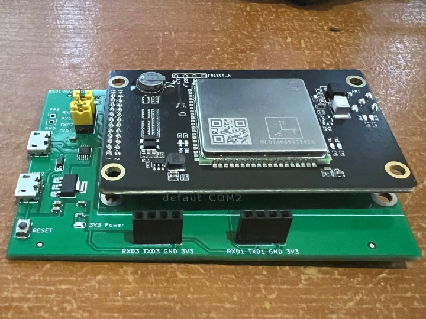
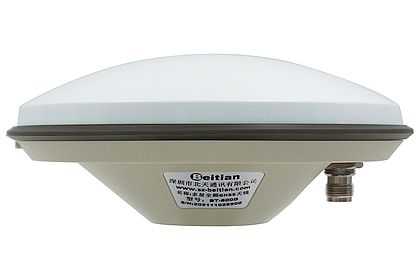

# HARDWARE.md — The Rover

A **ComNav SinoGNSS K803** OEM board, a **Seeed XIAO ESP32-C6**, a **Beitian BT-800D** antenna
and a power bank. Four wires between the boards.

> This is a bare **OEM receiver board**: the K803 module on a small PCB with power, UART and an
> antenna connector broken out. Nothing to disassemble.
>
> **Silkscreen, connector position and pin order are not guaranteed between board revisions** —
> verify with a multimeter before connecting anything. See [Connections](#connections).

- [The board](#the-board)
- [Connections](#connections)
- [Wiring — XIAO ESP32-C6](#wiring--xiao-esp32-c6)
- [Power](#power)
- [Antenna](#antenna)
- [Housing](#housing)
- [PPS (optional)](#pps-optional)
- [Bench test before you go out](#bench-test-before-you-go-out)
- [Photo checklist](#photo-checklist)

---

## The board

`SinoGNSS by ComNav Technology Ltd.`, model **K803**. Read the label on your module and record
it — it decides which features you actually have:

```
LOG VERSION          → model, firmware build, serial number, enabled authorizations
```

Capability, from ComNav's published material and the OEM Board Reference Manual V3.1. Your
unit's actual feature set depends on its **authorization** — confirm with `LOG VERSION`:

| | |
|---|---|
| Constellations | BDS, GPS, GLONASS, Galileo (multi-frequency) |
| RTK accuracy | ~8 mm + 1 ppm horizontal, ~15 mm + 1 ppm vertical |
| Correction input | RTCM 3.x |
| Output | NMEA 0183 + ComNav/NovAtel-style ASCII and binary logs |
| Ports | COM1 / COM2 / COM3, **3.3 V LVTTL**, default 115200 8N1 |
| Time pulse | 1 PPS output |
| Typical draw | 150–300 mA during acquisition — see [Power](#power) |

### What the K803 does not do

Two things people look for and will not find here:

- **Tilt compensation.** The `insrtk` command group (`insrtk rodlength`, `insrtk leverarmarp`,
  `insrtk leverarmgnss`, …) and the tilt logs of V3.1 §3.4.8 belong to a different board
  variant; on the K803 they are rejected, and no authorization changes that. Keep the pole
  vertical and enter its length as **Instrument Height** — the GIS app does the subtraction.
- **Dead reckoning — we do not use it.** DR is built for a moving platform that must keep
  reporting position through a tunnel or under tree cover. A pole rover that stops to take a
  point already has a clean sky, so DR adds no accuracy — and once INS is engaged the receiver
  starts reporting GGA quality `6` (GNSS/INS integrated) instead of an honest `4` (RTK FIXED),
  which a GIS app accepts as a valid fix. `INSCONTROL` / `SET SMOOTHEDDR` are therefore **not**
  in the boot sequence.
- What the IMU does give you is raw data: `LOG IMUDATAB` (ID 2264, gyro + accelerometer,
  100 Hz, supported on K803). See [TODO.md](TODO.md) item 5 for why building tilt compensation
  on it is a separate project.

> The COM ports are **3.3 V logic** and connect directly to an ESP32-C6 with no level shifter.
> Do **not** feed 5 V into a COM pin. If you are unsure about your board revision, scope the
> receiver's TX line before wiring it up — idle should sit at 3.3 V.

---

## Connections

Four signals: **5 V, GND, GNSS TX, GNSS RX**.

| Signal | Direction (receiver's point of view) | Goes to |
|---|---|---|
| **5 V** | Power **in** | XIAO `5V`, or a separate 5 V supply |
| **GND** | — | XIAO `GND` (**always connect, always first**) |
| **GNSS TX** | **Out** — NMEA to you | XIAO **RX** pin (`D7`) |
| **GNSS RX** | **In** — RTCM3 from you | XIAO **TX** pin (`D6`) |

Identify the pins on **your** board before powering anything:

1. **GND** — continuity to the PCB ground, mounting holes, connector shells.
2. **5 V** — with the original supply connected, measure 5 V ±5 % to GND. Disconnect again.
3. **TX vs RX** — power the board and probe each candidate pin with a USB-TTL adapter at
   115200 8N1. The one spitting text (`$GNGGA,…` or ComNav ASCII) is the receiver's **TX**.
   The remaining one is **RX**.
4. If the pins are unlabelled and you cannot identify RX: wire TX + GND first, confirm you
   receive data, then add RX and confirm the receiver answers `LOG VERSION`.



> **Placeholder:** `media/board-bottom.jpg` — bottom side: power and UART test points.
> **Placeholder:** `media/board-pinout.jpg` — the four signals called out on the board.

---

## Wiring — XIAO ESP32-C6

Build env `xiao_esp32c6_ble` (the only one). `UART1`, `PIN_GNSS_RX=17`, `PIN_GNSS_TX=16`.

| K803 board | XIAO pad | GPIO | Note |
|---|---|---|---|
| GNSS **TX** | **D7** | GPIO17 | ESP32 RX ← receiver TX |
| GNSS **RX** | **D6** | GPIO16 | ESP32 TX → receiver RX |
| **GND** | **GND** | — | Mandatory common ground |
| **5 V** | **5V** | — | VBUS passthrough from USB-C. Read [Power](#power). |

```
 K803 OEM board                              Seeed XIAO ESP32-C6
 ┌───────────────────────┐                   ┌───────────────────┐
 │  K803        COM1     │                   │                   │
 │   TX  ●─────── blue ──┼───────────────────┤ D7 (GPIO17)  RX   │
 │   RX  ●─────── green ─┼───────────────────┤ D6 (GPIO16)  TX   │
 │  GND  ●─────── yellow ┼───────────────────┤ GND               │
 │  5 V  ●─────── orange ┼───────────────────┤ 5V (VBUS)         │
 │                       │                   │                   │
 │  ANT ●── board port ──┼──▶ Beitian BT-800D │  USB-C ───────────┼──▶ power bank
 └───────────────────────┘    on the pole    └───────────────────┘
```

TX and RX cross over. If you get no data, swap those two first.

Notes specific to the C6:

- The C6 has **no Bluetooth Classic radio**, so the transport is BLE only. That is also what
  iOS requires.
- `ARDUINO_USB_CDC_ON_BOOT=1`: the console is the native USB port. It only enumerates once
  the host is attached, so the firmware waits up to 1.5 s at boot before logging.
- The onboard user LED is **active-low**; the build sets `LED_ACTIVE_LOW=1`.
- **BLE and the GNSS antenna are two different radios.** The XIAO has an RF switch for its
  own antenna, which the firmware does not touch, so the board default applies. If BLE range
  disappoints inside a printed box, that switch and the box's position relative to the GNSS
  antenna's ground plane are the first things to look at.

---

## Power

**This is the single most common failure in the whole project.** Read it before wiring.

### The numbers

- K803: **150–300 mA** during acquisition, more at cold start.
- Active antenna (LNA): typically 15–50 mA — check your antenna's datasheet.
- ESP32-C6 with BLE TX peaks: tens of mA in short bursts — much gentler than a Classic radio.
- A thin USB cable and a tired power bank still cannot serve all of it reliably.

### The failure mode

When 5 V sags, the 3.3 V rail follows, and the **flash chip stops responding** to the ROM
bootloader:

```
rst:0x7 (TG0WDT_SYS_RESET),boot:0x13 (SPI_FAST_FLASH_BOOT)
invalid header: 0xffffffff
flash read err, 988
```

There is usually **no** `Brownout detector was triggered` message — the detector trips at
about 2.43 V, but flash reads already fail nearer 2.8 V. People chase this as a firmware bug
for hours. It is not a firmware bug.

### Fix, in order

1. **Power the receiver from its own supply**, sharing **only GND** with the XIAO.
2. Add **470–1000 µF electrolytic + 100 nF ceramic** across 5 V / GND at the board.
3. Use a wall adapter or a power bank that can actually source the current, and a **short,
   thick** USB cable. Charge-only cables and 1 m of 28 AWG are both fatal here.

### Topologies that work

| Setup | Verdict |
|---|---|
| Power bank → XIAO USB-C → XIAO `5V` pin → receiver | ✅ Simplest. Power bank sources amps happily; the XIAO's 5 V pin is straight VBUS, not a regulator output. |
| Separate 5 V supply → receiver; USB → XIAO; **GND tied together** | ✅ Most robust. Do this on the bench. |
| XIAO `3V3` pin → receiver | ❌ Through the onboard regulator, and the receiver wants 5 V anyway. Do not. |
| Power supplies not sharing a ground | ❌ No common reference; UART will not work, and you can damage pins. |

### Bisecting a boot loop

Add one wire at a time: **GND** → **VCC** → **data lines**. Whichever step first triggers the
loop names the culprit. If it loops with GND + VCC and **no data wires attached**, it is
definitively power.

---

## Antenna

An **external antenna** on the board's antenna port: a **Beitian BT-800D** — a full-frequency
RTK mushroom antenna, active (built-in LNA), with published phase-centre calibration.



| | |
|---|---|
| GNSS code (NGS) | `BEIBT800D` |
| Bands | GPS L1/L2/L5 · BDS B1/B2/B3/B1C/B2a/B2b · GLONASS L1/L2/L3 · Galileo E1/E5a/E5b/E6 · SBAS · QZSS |
| Type | Active — LNA inside, needs DC on the centre pin |
| Antenna connector | **TNC** (on the pigtail), 50 Ω |
| ARP definition | **BAM** — Bottom of the Antenna Mount |
| Reference direction | RXC→North (the RF connector points north) |
| Phase centre offset (L1) | north **0.6 mm** · east **1.2 mm** · up **73.7 mm** |

The last two rows are the useful ones.

**ARP:BAM means measure to the bottom of the antenna mount**, not to the top of the radome or
the middle of the body. That is exactly the point a pole tape measure reaches, so
**Instrument Height** in the GIS app = ground to the bottom of the mount, and nothing else to
add. The 73.7 mm vertical phase-centre offset is a constant you cannot avoid and should not
try to correct by hand — it shifts every height the same way, so relative heights and
differences are unaffected.

RXC→North is an orientation reference for the calibration table, not a requirement to aim the
antenna north. The phase centre is stable to a couple of millimetres either way.

### Does the board feed the antenna?

The BT-800D is active, so it needs supply voltage on the centre pin. V3.1 documents no
antenna-power command, so measure instead of assuming:

1. Power the board, antenna connector empty.
2. Multimeter, DC volts, between the **centre pin** of the antenna connector and **GND**
   (connector shell / PCB ground).
3. Record it.

| Reading | Meaning | What to do |
|---|---|---|
| 0 V | The board does not power an LNA | Feed the antenna through an inline bias-tee off the same 5 V |
| 3.3 V / 5 V | Bias is present | Check it is within the antenna's rated supply before connecting |

Then confirm the LNA is actually alive: with the antenna connected and the board running,
`LOG COM1 GPGSV ONTIME 1` should show plausible SNR. A starved or dead LNA still lists
satellites — with **zero or near-zero SNR**, because the receiver sees the antenna's noise,
not the sky.

> **Placeholder:** `media/antenna-port.jpg` — the antenna connector on the board.
> **Placeholder:** `media/antenna-bias-voltage.jpg` — multimeter reading on the centre pin.

### Mounting

An RTK antenna is not a WiFi antenna: what matters is the sky above it and the metal below it.

- **Ground plane.** A patch antenna wants one, and its performance figures are quoted *over*
  a specific ground plane. Honour whatever the antenna's drawing specifies — a metal disc or
  the pole itself helps; a plastic bracket does nothing.
- **Cable.** Keep it as short as practical; every metre of cheap coax at L-band is real loss
  in front of the LNA, and a long unterminated lead is also an antenna. Route it so it does
  not drape across the sky above the patch.
- **Measure to the BAM.** Consistently, every setup.
- **Open sky.** Under a tree or against a wall you get FLOAT, not FIX.
- **Away from reflectors.** Metal roofs, cars and wet surfaces cause multipath.
- **Let it settle.** Cold start to RTK FIX in open sky is typically 30–60 s.

> **Placeholder:** `media/antenna-on-pole.jpg` — antenna mounted on the pole, cable routed.

---

## Housing

**TBD — printed enclosure.** Not designed yet, so this section is a placeholder on purpose;
nothing here has been measured.

What the box has to do, in order of importance:

1. **Keep the antenna's ground plane intact** and keep the antenna above everything else in
   the box. Do not put the ESP32, the battery or the USB cable between the antenna and the sky.
2. **Keep the two radios apart.** The GNSS antenna and the XIAO's BLE antenna should be as far
   apart as the box allows, with the battery not between them.
3. **Strain-relieve the antenna cable and the USB cable.** Neither connector should ever take
   a tug directly.
4. **Insulate the boards.** Kapton tape or printed trays. No board may rest against the
   antenna feed or a ground plane.
5. **Weather.** If the box goes on a pole outdoors, it needs a drain, not a seal — a sealed
   box in the sun pumps moist air in and out through the cable glands.

> **Placeholder:** `media/housing-print.jpg` — printed parts before assembly.
> **Placeholder:** `media/housing-open.jpg` — assembled box, boards and battery visible.
> **Placeholder:** `media/housing-on-pole.jpg` — finished rover on the pole with the antenna.

---

## PPS (optional)

The K803 exposes a **1 PPS** time-pulse output. The firmware configures it
automatically during init (`PPSCONTROL ENABLE POSITIVE 1 1000 1`, V3.1 §2.2.15)
and captures it on **GPIO2 / D2 / A2** via an interrupt — the periodic stats
line on the USB console reports the frequency (should be ~1.000 Hz).

Wire it if you need a hardware time reference (camera triggering, sensor fusion,
NTP server, post-processed kinematics). NMEA timestamps alone are fine for
basic GIS work.

| Signal | Level | Suggested XIAO pin | Notes |
|---|---|---|---|
| PPS | 3.3 V logic, ~1 Hz pulse | GPIO2 (D2 / A2) | Keep the lead short; it is a timing reference |

You will need to locate the PPS pad on your board revision — it is not part of
the four signals in [Connections](#connections). Attach a scope or a logic
analyser and look for the 1 Hz pulse once the receiver has a position fix; PPS
is typically not asserted before then.

> **Placeholder:** `media/pps-pad.jpg` — PPS test point identified on the board.

---

## Bench test before you go out

1. Connect **GND only**, then power the receiver from its own supply. Confirm no boot loop.
2. Flash the firmware ([FLASHING.md](FLASHING.md)) and open the serial monitor at 115200.
3. Add the receiver **TX → ESP RX** wire. In the boot log, the `[<]` lines should show
   replies from the K803 rather than `(no response)`:

   ```
   [GNSS] K803 rover init on COM1
   [>] INTERFACEMODE COMPASS COMPASS ON
   [<] $command,INTERFACEMODE COMPASS COMPASS ON,response: OK*…
   [>] LOG VERSION
   [<] #VERSIONA,COM1,…
   ```

4. Add the **ESP TX → receiver RX** wire and reboot. Commands should now be accepted; watch
   for `REJECTED` lines (see [COMMANDS.md](COMMANDS.md)). Nothing in the shipped sequence is
   IMU-related any more, so **no line should be rejected on a plain K803**. A rejection on
   `INTERFACEMODE COM1 AUTO AUTO ON` is the one to take seriously — see
   [COMMANDS.md → Interface mode](COMMANDS.md#interface-mode-and-differential-input).
5. Connect the antenna and take it outside. Within a minute the `[STAT]` line should show real
   traffic:

   ```
   [STAT] BLE linked  up 512 B/s (25600)  down 0 B/s (0)
   ```

6. Connect a phone, start an NTRIP client, and confirm `down` goes above 0 and the fix
   reaches **RTK FIX**.
7. Check GSV SNR values once you have a fix — that is how you notice a starved LNA before it
   costs you a day of survey.

---

## Photo checklist

Photos worth capturing — drop them in `media/` and the placeholders above become real:

| File | Shot |
|---|---|
| `board-top.jpg` | K803 module on the carrier board, top side — ✅ in repo |
| `board-bottom.jpg` | Bottom: power and UART test points |
| `board-pinout.jpg` | The four signals called out on the board |
| `antenna-port.jpg` | Antenna connector on the board |
| `antenna-bias-voltage.jpg` | Multimeter reading on the antenna centre pin |
| `antenna-bt800d.jpg` | Beitian BT-800D, TNC connector on the pigtail — ✅ in repo |
| `antenna-on-pole.jpg` | Beitian BT-800D on the pole, cable routed |
| `wiring-xiao.jpg` | XIAO wired up, wire colours visible |
| `housing-print.jpg` | Printed parts |
| `housing-open.jpg` | Assembled box, boards and battery visible |
| `housing-on-pole.jpg` | Finished rover on the pole |
| `dashboard.png` | Web dashboard with a live RTK fix |

---

Next: **[COMMANDS.md](COMMANDS.md)** — how the K803 is switched from base to rover.
