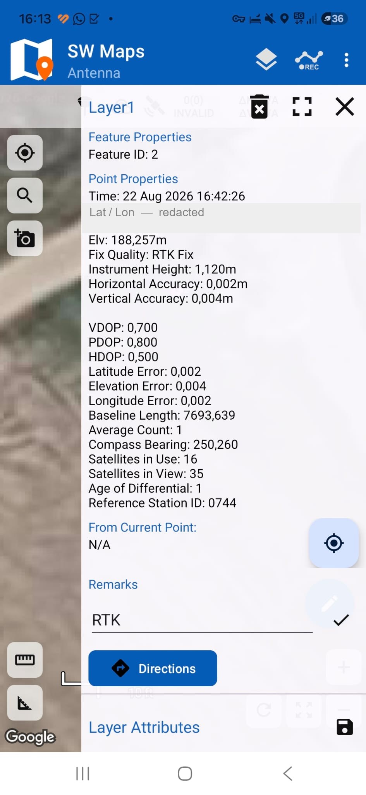
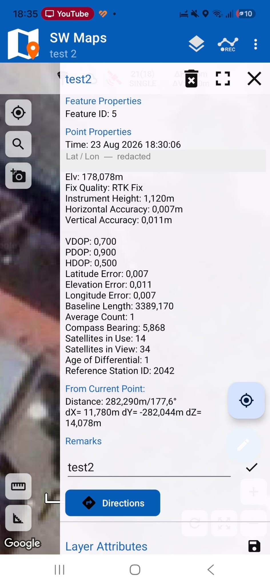

# ESP_RTK_ROVER

**A DIY centimetre-accurate GNSS rover.**

<p align="center">
  <b><a href="install/">⚡ Flash in your browser</a></b> ·
  <b><a href="web/rtk-monitor.html">🛰️ Live Dashboard</a></b> ·
  <a href="HARDWARE.md">🔧 Hardware</a> ·
  <a href="COMMANDS.md">📡 K803 Commands</a> ·
  <a href="FLASHING.md">📖 Flashing</a>
</p>

---

## What it is

ECOVACS GOAT lawnmowers ship with an RTK base station — the black dome you screw onto a pole.
People sell them second-hand when they change mowers.

Inside is a **SinoGNSS K803** by ComNav: a multi-frequency GNSS board with a real RTK engine,
an IMU (dead-reckoning), a patch antenna and a machined ground plane.

This project wires that board to a **Seeed Studio XIAO ESP32C6** and turns the dome into a
BLE RTK rover that any mobile GIS app can talk to.

```
  phone  (NTRIP client + GIS app)
    │   RTCM3 down  ·  NMEA up
    │   Bluetooth LE
  XIAO ESP32C6
    │   UART 115200
  ComNav K803  ──  patch antenna + ground plane
```

The firmware:

- **reconfigures the K803 from base station to rover on every boot** — no laptop before a survey
- **passes bytes both ways, transparently** — NMEA up, RTCM3 corrections down
- **speaks BLE** (Nordic UART Service, works on iOS and Android)
- **ships a browser dashboard** for live diagnostics

---

## ⚠️ This is a DIY device, not a survey instrument

Read this before using it for anything that matters.

- **No calibration.** The antenna has no phase-centre calibration. Heights carry an unknown
  constant offset, probably a few centimetres.
- **No certification.** No type approval, no conformity assessment, no traceability to a
  national standard.
- **No integrity monitoring.** Commercial receivers add interference detection, multipath
  mitigation and integrity checking. This has none. **A false fix looks exactly like a good
  one.**
- **No support.** If it gives you a wrong answer, there is nobody to call. That, more than the
  silicon, is what the expensive units are really selling.

**Do not use it for:** cadastral or land-registry work, legal boundaries, construction
setting-out, aviation, marine navigation, or anything where a wrong position hurts someone.

Use at your own risk.

## What it *is* good for

| Use | Why it fits |
|---|---|
| **Robotics** | Autonomous rovers and mowers, ground stations, drone pads — centimetre positioning at hobby cost |
| **DIY auto-steering** | Tractor guidance and precision-agriculture experiments |
| **Hobbyist survey & mapping** | Field boundaries, garden and site layout, trails, asset mapping |
| **Learning GNSS / RTK** | A genuine multi-frequency receiver to experiment with, for the price of a takeaway |

---

## How accurate is it?

Two field tests against official government height benchmarks, using free NTRIP corrections.
Then we stopped — this is a hobby device, and characterising it properly needs reference
equipment we do not have.

### Test 1 — field test, 22 Aug 2026

<p align="center">
  
</p>

**RTK FIX.** 16 satellites, PDOP 0.80, corrections 1 s old, 7.7 km baseline. The receiver's own
precision estimate: 2 mm horizontal, 4 mm vertical.

We went to check it against an official first-order height benchmark. The physical mark turned
out to be a bolt on the *side* of a granite pillar, and we never found it — so there was nothing
to compare against. The measurement itself came out sane.

### Test 2 — a nearby building, 23 Aug 2026

<p align="center">
  
</p>

**RTK FIX.** 14 satellites, PDOP 0.90. Precision estimate 7 mm horizontal, 11 mm vertical —
worse than test 1, because the antenna was standing right against a wall.

This time the benchmark was found: a bolt in the wall, 0.28 m above the paving, with a published
official height.

> **Measured ellipsoidal height − official height = 48.71 m**

That difference should be the *geoid separation*. It lands within about a centimetre of what
test 1 implied, from a site 14 km away.

### What that proves — and what it doesn't

✅ The receiver produces a stable RTK fix, correctly referenced, with no gross error
✅ Two independent sites agree with each other

❌ It is **not** an accuracy figure. The millimetre numbers the app displays are the receiver
grading its own homework
❌ It does not separate the antenna's own offset from the geoid model — that would need the
official geoid value, a proper 15-minute occupation, and repeat visits on different days

**Treat heights as good to a few centimetres, not millimetres.** Horizontal behaves better than
vertical. If you need certainty, buy a certified instrument.

---

## Hardware

| Item |
|---|
| ECOVACS GOAT RTK base station (second-hand) |
| [Seeed Studio XIAO ESP32C6](https://www.seeedstudio.com/Seeed-Studio-XIAO-ESP32C6-p-5884.html) |
| USB power bank, wire, heat-shrink |

<p align="center">
  
</p>

| K803 harness | XIAO ESP32C6 | Note |
|---|---|---|
| **GNSS TX** (blue) | `D7` / GPIO17 | ESP32 RX ← receiver TX |
| **GNSS RX** (green) | `D6` / GPIO16 | ESP32 TX → receiver RX |
| **GND** (yellow) | `GND` | Mandatory common ground |
| **5 V** (orange) | `5V` | VBUS passthrough from USB-C |

TX and RX cross over. If you get no data, swap those two first.

> ⚠️ **Power the receiver properly.** It pulls 150–300 mA. Feeding it from a 3.3 V regulator
> causes boot loops that look like corrupted firmware.
> See [HARDWARE.md → Power](HARDWARE.md#power).

Full teardown, pinouts and assembly: **[HARDWARE.md](HARDWARE.md)**

---

## Flash it

**XIAO ESP32C6 — one click, no toolchain:**
**[alkssav.github.io/ESP_RTK_ROVER/install](https://alkssav.github.io/ESP_RTK_ROVER/install/)**
— Chrome or Edge on desktop.

```powershell
pio run -t upload    # XIAO ESP32C6, BLE (default env)
pio device monitor   # console @ 115200
```

Details: **[FLASHING.md](FLASHING.md)**

---

## Connect your phone

<p align="center">
  
  &nbsp;&nbsp;
  
</p>

In **SW Maps** (Android / iOS):

1. **☰ → Bluetooth GNSS**
2. **Connection Mode**: `Bluetooth LE`
3. Pick `ESP32-RTK-XXXX`
4. **Instrument Model**: `Generic NMEA` — set **Instrument Height** to your pole length
5. **Connect**
6. **☰ → NTRIP Client** → your caster details → **Connect**
7. Wait for `SINGLE` → `FLOAT` → **`RTK FIX`**

Also works with **QField**, **Mergin Maps**, **Mapit GIS**.

Corrections come from your phone, not the ESP32 — the phone already has the internet connection.
Any NTRIP caster serving RTCM 3.x works.

> Note: SW Maps **subtracts** the instrument height from the elevation it stores. Enter your pole
> length and it records the ground point; leave it empty and it records the antenna.

---

## Live dashboard

**[Open the dashboard →](https://alkssav.github.io/ESP_RTK_ROVER/web/rtk-monitor.html)**

One self-contained HTML file. Connects to the rover over Web Bluetooth in Chrome or Edge and
decodes the stream live: fix quality, position, σ values, DOPs, correction age, and a raw NMEA
log with checksum errors highlighted. Nothing is uploaded anywhere — your position stays in your
browser.

---

## Documentation

| | |
|---|---|
| **[HARDWARE.md](HARDWARE.md)** | Teardown, pinout, wiring, power, antenna, assembly |
| **[COMMANDS.md](COMMANDS.md)** | The ComNav K803 command set — base → rover, NMEA rates, recovery |
| **[FLASHING.md](FLASHING.md)** | Web flashing, PlatformIO, esptool, troubleshooting |

Firmware layout: `src/main.cpp` moves bytes, `src/gnss_init.cpp` configures the K803,
`src/link_ble.cpp` implements the BLE transport.

---

## Credits

**Hussein Daj** — hardware reverse engineering, teardown, K803 command discovery, field testing.

**Claude (Anthropic)** — project partner: firmware architecture, dashboard and documentation.

Thanks to **[Seeed Studio](https://www.seeedstudio.com/Seeed-Studio-XIAO-ESP32C6-p-5884.html)**
for the XIAO ESP32C6, and to
**[NimBLE-Arduino](https://github.com/h2zero/NimBLE-Arduino)**,
**[pioarduino](https://github.com/pioarduino/platform-espressif32)** and
**[ESP Web Tools](https://github.com/esphome/esp-web-tools)**.

Thanks also to the GNSS professionals who pushed back on the first version of these accuracy
claims — the limitations section exists because of them.

## License

[MIT](LICENSE) — do what you like, credit appreciated, no warranty.

## Disclaimer

Not affiliated with, endorsed by or supported by **ECOVACS**, **ComNav Technology** or
**SinoGNSS**. Opening the base station voids any warranty and ends its usefulness to the mower.
Trademarks belong to their owners.

**This is a hobbyist instrument. It is not certified for any regulated purpose.**